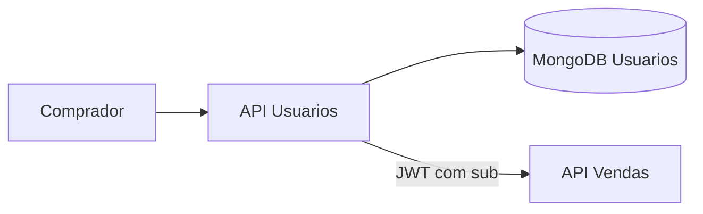

# API Design System — Usuarios e Autenticação

## Propósito e fronteira

Esta API é o contexto de compradores: cadastra dados pessoais, armazena senha com BCrypt e emite JWT. Ela não cria vendas e não acessa o MongoDB de Vendas.



## Convenções

- Prefixo versionado: `/api/v1`.
- JSON em `camelCase`; datas em ISO 8601 UTC.
- CPF é persistido como string numérica sem máscara; e-mail é normalizado em minúsculas.
- Erros seguem `ProblemDetails`: `400` para validação, `401` para credenciais inválidas e `409` para CPF/e-mail duplicados.
- `GET /health/live`, `GET /health/ready` e `/swagger` estão disponíveis para operação e descoberta.

## Recursos HTTP

| Método e rota | Corpo | Resultado |
| --- | --- | --- |
| `POST /api/v1/users` | nome, CPF, e-mail, senha e papel | `201 Created` |
| `GET /api/v1/users` | - | `200 OK` com a lista de usuários |
| `GET /api/v1/users/{id}` | - | `200 OK` com o usuário |
| `PUT /api/v1/users/{id}` | nome, CPF, e-mail, papel e senha opcional | `200 OK` |
| `DELETE /api/v1/users/{id}` | - | `204 No Content` |
| `POST /api/v1/auth/login` | e-mail e senha | `200 OK` com JWT |

### Cadastro

```json
{
  "name": "Maria Silva",
  "cpf": "52998224725",
  "email": "maria@example.com",
  "password": "senha-segura"
}
```

### Login

```json
{ "email": "maria@example.com", "password": "senha-segura" }
```

A resposta contém `accessToken` e `expiresAt`. O token é HMAC, assinado com `Jwt__Key`, e traz ao menos `sub`, `email`, `role`, `iss`, `aud` e `exp`. A API de Vendas valida assinatura, emissor, audiência e expiração antes de aceitar uma compra.
