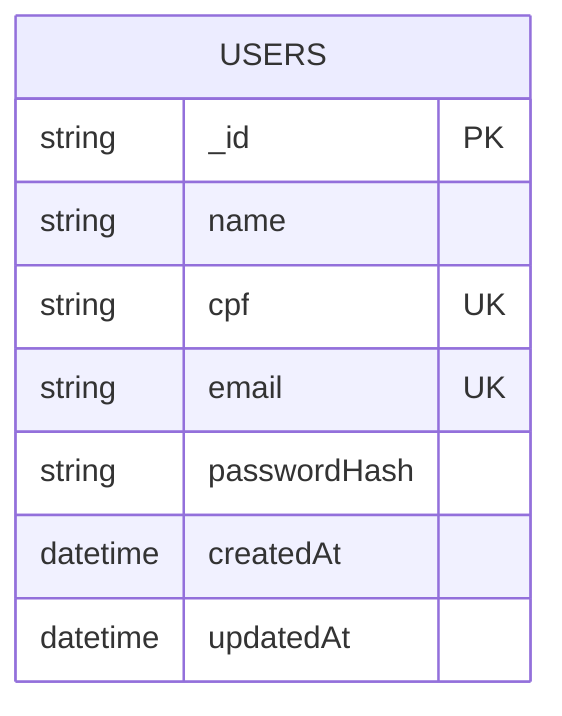

# Modelo de Dados — MongoDB de Usuarios

O banco `revenda_usuarios` é exclusivo do contexto de compradores. A senha nunca é persistida em texto puro: apenas o hash BCrypt é armazenado.

| Coleção | Índice | Objetivo |
| --- | --- | --- |
| `users` | único em `{ cpf: 1 }` | Impede cadastro duplicado por CPF. |
| `users` | único em `{ email: 1 }` | Impede contas duplicadas e permite autenticação. |

O identificador `_id` é emitido como claim `sub` no JWT. A API de Vendas usa somente esse identificador para relacionar a compra ao comprador, sem compartilhar coleções ou credenciais de banco.
